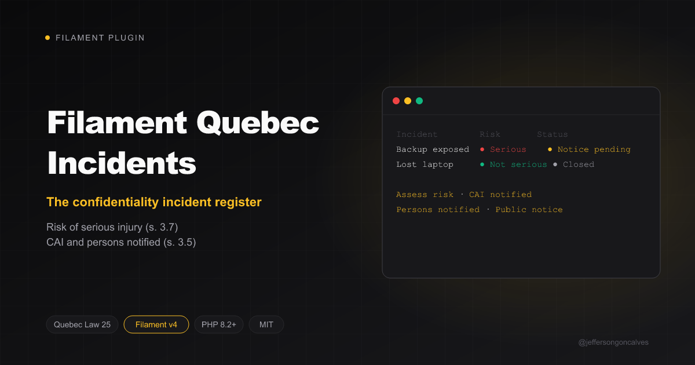

<div class="filament-hidden">



</div>

# Filament Quebec Incidents

[](https://packagist.org/packages/jeffersongoncalves/filament-quebec-incidents)
[](https://github.com/jeffersongoncalves/filament-quebec-incidents/actions?query=workflow%3Atests+branch%3A2.x)
[](https://github.com/jeffersongoncalves/filament-quebec-incidents/actions?query=workflow%3A"Fix+PHP+code+styling"+branch%3A2.x)
[](https://packagist.org/packages/jeffersongoncalves/filament-quebec-incidents)
[](LICENSE.md)

The Filament panel for [laravel-quebec-incidents](https://github.com/jeffersongoncalves/laravel-quebec-incidents): the register of confidentiality incidents that Quebec's private sector privacy act (Law 25) requires (s. 3.8), with the notices to the Commission d'accès à l'information (CAI) and to the persons concerned.

## Features

- Register an incident: when you became aware of it (locked afterwards), what happened, the information and the number of persons concerned. Each entry is kept 5 years (s. 11 of the regulation).
- **Assess risk:** whether the incident presents a risk of serious injury, from the sensitivity of the information, the anticipated consequences of its use and the likelihood of injurious use (s. 3.7).
- For a risk of serious injury, record the **CAI notice** (with its reference) and the **persons notice** (s. 3.5), a **public notice** instead of individual ones (s. 5 of the regulation), or **defer** the persons notice while it could hamper an investigation.
- **Close** with the measures taken to reduce the risk and prevent new incidents.
- Status badge (open, notice pending, overdue, closed), "Notice pending" and "Overdue" filters, and a navigation badge with pending incidents (red when one is past your notice target).
- 19 languages.

## Compatibility

| Plugin Version                                                                | Filament |
|-------------------------------------------------------------------------------|----------|
| [1.x](https://github.com/jeffersongoncalves/filament-quebec-incidents/tree/1.x) | 3.x      |
| [2.x](https://github.com/jeffersongoncalves/filament-quebec-incidents/tree/2.x) | 4.x      |
| [3.x](https://github.com/jeffersongoncalves/filament-quebec-incidents/tree/3.x) | 5.x      |

## Installation

You can install the package via composer:

```bash
composer require jeffersongoncalves/filament-quebec-incidents:"^2.0"
php artisan vendor:publish --tag="quebec-incidents-migrations"
php artisan migrate
```

## Usage

```php
use JeffersonGoncalves\Filament\QuebecIncidents\QuebecIncidentsPlugin;

public function panel(Panel $panel): Panel
{
    return $panel
        ->plugins([
            QuebecIncidentsPlugin::make()
                ->navigationGroup('Quebec')             // default: no group
                ->navigationSort(40)
                ->navigationIcon('heroicon-o-exclamation-triangle')
                ->slug('incidents'),
        ]);
}
```

All fluent methods are optional. The act says "promptly": your notice target (72 hours by default) is configured in laravel-quebec-incidents' `quebec-incidents` config. Schedule `quebec:incidents-overdue` to be alerted outside the panel.

> The resource has no authorization of its own: register it only on panels whose users handle incidents, or add a policy for `JeffersonGoncalves\QuebecIncidents\Models\Incident`. Records younger than 5 years can't be deleted.

## Testing

```bash
composer test
```

## Changelog

Please see [CHANGELOG](CHANGELOG.md) for more information on what has changed recently.

## Contributing

Please see [CONTRIBUTING](.github/CONTRIBUTING.md) for details.

## Security Vulnerabilities

Please review [our security policy](../../security/policy) on how to report security vulnerabilities.

## Credits

- [Jefferson Gonçalves](https://github.com/jeffersongoncalves)
- [All Contributors](../../contributors)

## License

The MIT License (MIT). Please see [License File](LICENSE.md) for more information.
